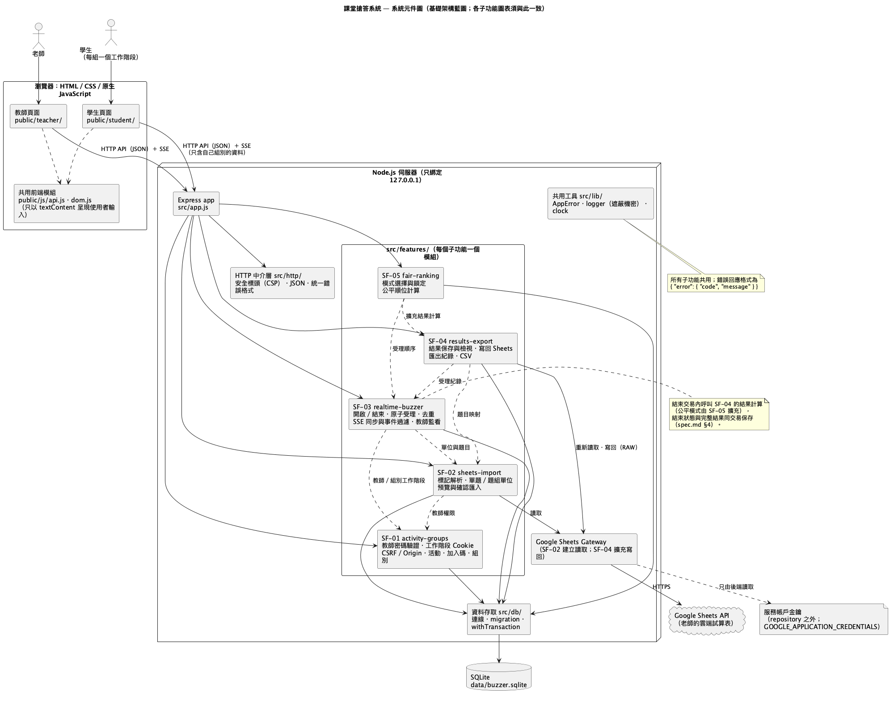
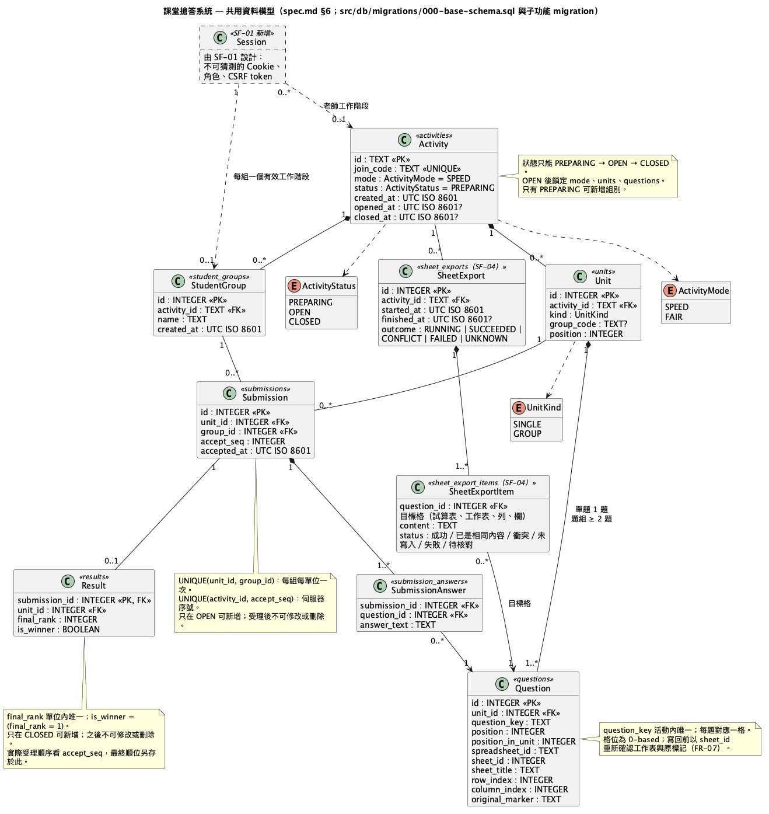
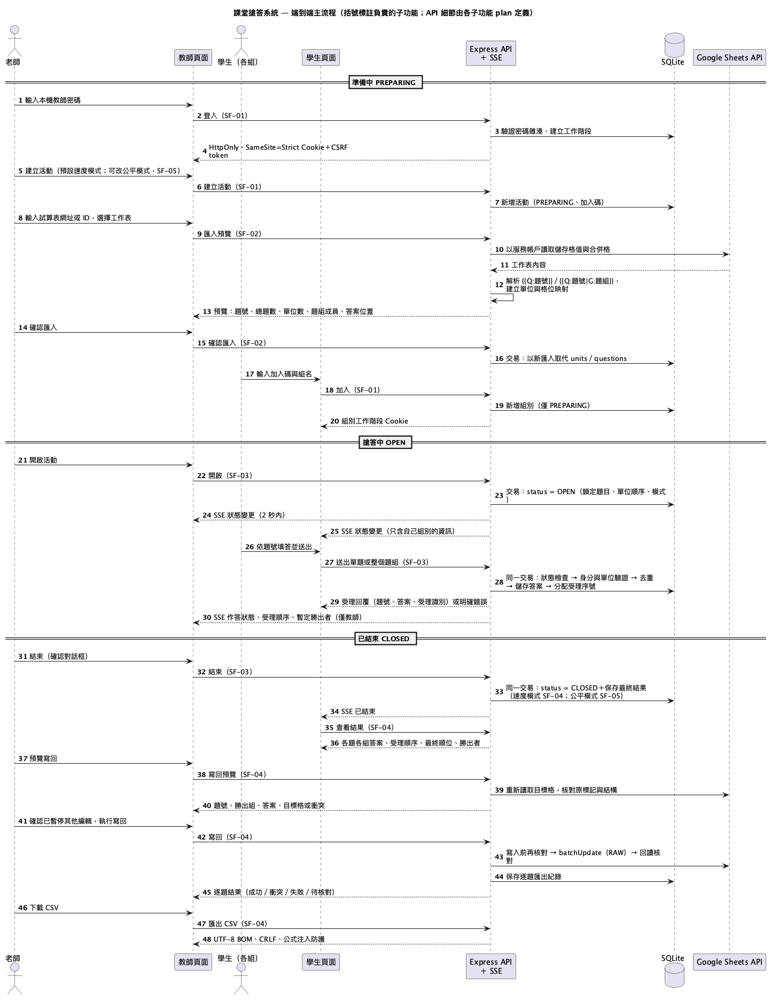

# 課堂搶答系統（SpecKit 組）

把學生上台填寫 Guided Notes 的流程改為線上搶答：老師直接從自己的 **雲端 Google Sheets** 匯入題目、
控制活動、監看作答，結束後把勝出答案 **寫回同一份試算表的原答案格**，並可下載 CSV；
學生以組別加入、依題號送出答案，結束後查看結果。

- 產品規格與驗收基準：[`spec.md`](spec.md)（v1.0，**不得任意修改**；變更依 §10 程序）
- 工程原則：[`.specify/memory/constitution.md`](.specify/memory/constitution.md)
- 開發方法：[GitHub Spec Kit](https://github.com/github/spec-kit) 1.2.1，Claude Code 整合

> 已實作教師驗證、活動建立與學生組別加入（SF-01），以及 Google Sheets 線上題目匯入（SF-02）。

## 快速開始

需求：Node.js 26 LTS（最低 24，見 `.nvmrc`）；產生圖表需要 PlantUML CLI（含 Java 與 Graphviz）。

```sh
npm ci            # 依 package-lock.json 安裝鎖定版本
npm test          # 執行自動化測試
npm run setup:teacher  # 首次啟動前，在本機輸入教師密碼
npm start         # http://127.0.0.1:3000（只綁定 localhost）
npm run diagrams  # 以 PlantUML CLI 將 diagrams/*.puml 轉成同目錄 PNG
```

PlantUML 安裝：macOS 執行 `brew install plantuml`；其他平台請安裝 Java 與
[PlantUML](https://plantuml.com/starting)，把 `plantuml` 加入 PATH，或設定 `PLANTUML_JAR`
指向 `plantuml.jar`。

教師開啟 `/teacher/` 登入並建立活動。學生在各自的瀏覽器工作階段開啟 `/student/`，輸入活動加入碼與組名。

### 環境變數

複製 `.env.example` 為 `.env`（不進版控），`npm start` 會自動讀取。

| 變數 | 預設 | 說明 |
| --- | --- | --- |
| `PORT` | `3000` | 監聽埠 |
| `HOST` | `127.0.0.1` | 只接受 `127.0.0.1`、`::1`、`localhost` |
| `DATA_DIR` | `./data` | SQLite 等本機資料（已排除版控） |
| `DATABASE_FILE` | `<DATA_DIR>/buzzer.sqlite` | 可設為 `:memory:` |
| `GOOGLE_APPLICATION_CREDENTIALS` | 未設定 | 服務帳戶金鑰的路徑，**必須在 repository 之外** |

### Google Sheets 服務帳戶

1. 在 Google Cloud Console 建立專案並啟用 **Google Sheets API**。
2. 建立服務帳戶並下載 JSON 金鑰，存放在 repository 之外（例如
   `~/.config/classroom-buzzer/service-account.json`，並 `chmod 600`）。
3. 在 `.env` 設定 `GOOGLE_APPLICATION_CREDENTIALS` 為該檔的絕對路徑。
4. 老師把自己的 Guided Notes 雲端副本「共用」給服務帳戶 email（編輯者權限）；
   不需要公開分享，也不需要 Drive 全域權限。
5. 在原答案空格填入標記。單題例如 `{{Q:1}}`，題組例如 `{{Q:2|G:A}}`。同一題組至少兩題，答案格不能合併。
6. 啟動伺服器，在教師頁建立活動。輸入雲端表網址或 ID，依需要的掃描順序選工作表。檢查預覽中的題號、題組及格位後，按「確認匯入」。

## 專案結構

```text
spec.md                     產品規格（唯一基準，不得任意修改）
.specify/                   Spec Kit：constitution、templates、scripts、extensions
.claude/skills/             Spec Kit 的 Claude Code skills（/speckit-*）
specs/NNN-<slug>/           各子功能的 spec.md、plan.md、tasks.md 等
diagrams/                   PlantUML 原始檔與 PNG（system-* 為系統基準圖）
src/
  server.js                 進入點：設定、migration、只綁定 localhost
  app.js                    Express app；各子功能 router 在此掛載
  config.js                 環境變數設定
  http/                     安全標頭、統一錯誤處理
  db/                       SQLite 連線、withTransaction、migrations/
  lib/                      AppError、logger（遮蔽機密）、clock
  features/<slug>/          各子功能模組（見 src/features/README.md）
public/                     前端（HTML／CSS／原生 JS）：teacher/、student/、js/、css/
tests/                      unit/、integration/、helpers/（test app 與 fixtures）
tools/speckit-plantuml/     自製 Spec Kit extension（PlantUML 圖表 hook）
```

## Spec Kit 開發流程

各子功能的編號、目錄與分支事先固定，兩人平行開發時才不會撞號：

| 子功能 | 功能目錄 | 分支 | 需求 | 驗收 | 依賴 |
| --- | --- | --- | --- | --- | --- |
| SF-01 活動與組別 | `specs/001-activity-groups` | `feat/001-activity-groups` | FR-01 | AC-04、AC-08、AC-16（身分部分） | — |
| SF-02 線上題目匯入 | `specs/002-sheets-import` | `feat/002-sheets-import` | FR-02、FR-08（匯入） | AC-01～AC-03、AC-17 | SF-01 |
| SF-03 即時搶答 | `specs/003-realtime-buzzer` | `feat/003-realtime-buzzer` | FR-03～FR-05、FR-08（送出） | AC-04～AC-10、AC-15、AC-16、AC-18 | SF-01、SF-02 |
| SF-04 結果與匯出 | `specs/004-results-export` | `feat/004-results-export` | FR-06、FR-07、FR-09 | AC-11～AC-14、AC-17、AC-19、AC-20 | SF-02、SF-03 |
| SF-05 公平排序 | `specs/005-fair-ranking` | `feat/005-fair-ranking` | FR-10 | AC-21～AC-23 | SF-03、SF-04 |

在 Claude Code 中（以 SF-02 為例）：

1. 從最新的 `main` 開始：`git switch main && git pull`
2. 撰寫規格，並指定分支與目錄：

   ```text
   /speckit-specify GIT_BRANCH_NAME=feat/002-sheets-import SPECIFY_FEATURE_DIRECTORY=specs/002-sheets-import
   依 spec.md §9.1 實作 SF-02「線上題目匯入」：FR-02、FR-08（匯入部分），驗收 AC-01～AC-03、AC-17。
   ```

   git extension 會建立分支；`after_specify` hook 會自動執行 `/speckit-plantuml-diagrams`，
   產生 component、class、sequence 三種 `.puml` 與 PNG（DC-03）。
3. （建議）`/speckit-clarify` → `/speckit-plan`（以圖表為藍圖）→ `/speckit-tasks`
   →（建議）`/speckit-analyze`
4. （選用）`/speckit-taskstoissues` 把 tasks 轉成 GitHub issues（需要 GitHub MCP；也可手動用 `gh issue create`）
5. `/speckit-implement`；完成後 `after_implement` hook 會執行 `/speckit-plantuml-sync`，
   核對程式與圖表，並記錄於 `specs/NNN-<slug>/diagram-sync.md`
6. 推送分支、以 PR 範本開 PR，指定另一位組員 review，處理意見後合併

換電腦或重新 clone 後，Spec Kit 不會從分支名稱推回功能目錄（`.specify/feature.json` 不進版控），
繼續作業前先指定一次：

```sh
printf '{"feature_directory": "specs/002-sheets-import"}\n' > .specify/feature.json
```

若組員使用其他 AI 代理，可用 `specify integration install <agent>` 加裝對應的 Spec Kit 指令。

## 分工表

依 spec.md §9.2，只記錄真實的 PR、作者與審閱者，完成後再填入。

| 項目 | 負責人 | Issue | 實作 PR | 審閱者 | 驗收紀錄 |
| --- | --- | --- | --- | --- | --- |
| 基礎架構 | 45678XYZ | — | — | — | — |
| SF-01 活動與組別 | tom1030507 | [#2](https://github.com/tom1030507/classroom-buzzer-system-speckit/issues/2) | [#24](https://github.com/tom1030507/classroom-buzzer-system-speckit/pull/24) | — | [驗收](specs/001-activity-groups/acceptance.md) |
| SF-02 線上題目匯入 | tom1030507 | [#5](https://github.com/tom1030507/classroom-buzzer-system-speckit/issues/5) | — | — | [驗收](specs/002-sheets-import/acceptance.md) |
| SF-03 即時搶答 | 待指派 | — | — | — | — |
| SF-04 結果與匯出 | 待指派 | — | — | — | — |
| SF-05 公平排序 | 待指派 | — | — | — | — |

## 系統圖表

基準圖位於 `diagrams/system-*`，各子功能的圖表必須與其一致（constitution 原則 VI）。

| 圖 | 原始檔 |
| --- | --- |
|  | [system-component.puml](diagrams/system-component.puml) |
|  | [system-class.puml](diagrams/system-class.puml) |
|  | [system-sequence.puml](diagrams/system-sequence.puml) |

## 協作規則摘要

- 功能與修正一律從 `main` 開分支、經 PR 合併，不直接推送 `main`；PR 由另一位組員實質 review。
- 每人至少一筆自己提出並合併的 PR，以及一筆對另一位組員的實質 review（spec.md §9.2）。
- 合併前：`npm test` 通過、圖表已同步、沒有機密進入版控。
- 機密（服務帳戶金鑰、`.env`、`data/`、教師設定、工作階段）絕不提交。
