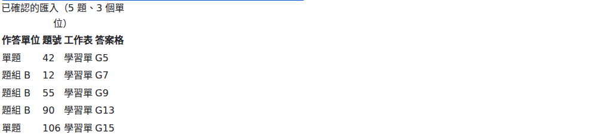
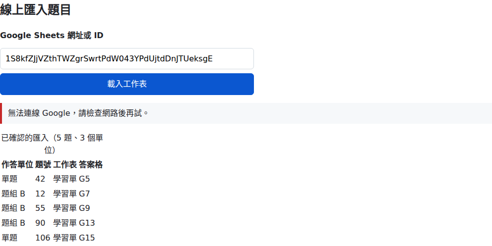

# SF-02 驗收紀錄

負責人為 tom1030507。驗收範圍見 [SF-02 規格](spec.md)。

## 自動化

Node.js 24.17.0 上，28 項 SF-02 測試通過。執行方式為 `node --test --test-reporter=spec 'tests/{unit,integration}/sheets-import/*.test.js'`。

- **AC-02（匯入）、AC-17（匯入）**。解析器測試包含兩張不同格線版面的工作表、五道非連續題號、三個作答單位、跨工作表的三成員題組與 AA 欄之後的格位。HTTP 測試確認教師預覽與保存的題號、格位、原標記一致。[解析器測試](../../tests/unit/sheets-import/parser.test.js) · [匯入 API 測試](../../tests/integration/sheets-import/import.test.js)
- **AC-03**。測試零題、重複和非法標記（含全形與混用標記）、合併儲存格、單成員題組、無權限、試算表不存在、配額、斷網和逾時。HTTP 測試驗證預覽、讀取、寫入失敗時舊匯入仍可查詢，並以 SQLite trigger 確認部分寫入失敗會復原。測試也涵蓋 Google 讀取尚未完成時活動已開啟的競態。[Gateway 測試](../../tests/unit/sheets-import/gateway.test.js) · [匯入 API 測試](../../tests/integration/sheets-import/import.test.js)
- **教師權限與階段**。HTTP 測試驗證教師登入、Origin／CSRF、階段鎖定及預覽僅限原活動和原工作階段。[匯入 API 測試](../../tests/integration/sheets-import/import.test.js)

## 真實線上試算表驗收

2026-11-20 在主分支提交 `ee9d045` 上完成。教師頁使用專案的 Google Sheets Gateway 和服務帳戶連線，兩份驗收檔都由課程範本複製，並共用給服務帳戶。Node.js 24.17.0 的 129 項專案自動化測試皆通過。

### AC-01、AC-17 教師預覽與確認

在題組副本先勾選「學習單」及「跨表驗收」，再將「跨表驗收」上移為第一張。預覽及確認後都顯示五題、三個作答單位。確認後重新整理，仍讀到相同的題號、題組及答案格。檢查 API 回傳的工作表 ID、列欄索引及原始標記，皆與試算表相符。[題組範本副本](https://docs.google.com/spreadsheets/d/1ruqRlenKP93uO5gv0iSuvWA9gqQyfHVLtS9Eo4bplo8/edit)

- 題組 A 的第 14 題位於「跨表驗收」H6，第 6、9 題位於「學習單」H5、H8。
- 單題 81 位於「跨表驗收」G13，單題 3 位於「學習單」G11。

### AC-02 更換版面後重新匯入

在同一場準備中的活動，改用單題範本副本，選取「學習單」後預覽並確認。五題、三個作答單位取代先前的題組副本匯入，重新整理後結果一致。[單題範本副本](https://docs.google.com/spreadsheets/d/1S8kfZJjVZthTWZgrSwrtPdW043YPdUjtdDnJTUeksgE/edit)

- 單題 42、106 分別位於 G5、G15。
- 題組 B 的第 12、55、90 題分別位於 G7、G9、G13。

### AC-03 錯誤回報及既有資料保留

在教師頁觸發下列錯誤。所有案例都顯示對應訊息，並透過教師頁和已確認匯入 API 核對先前的五題、三個作答單位及其格位皆完整保留。

- 未共用的真實試算表回傳 `SHEETS_PERMISSION`。不存在的試算表 ID 回傳 `SHEETS_NOT_FOUND`。
- 驗收副本的暫存工作表分別驗證零題、重複題號、非法標記、合併答案格及單成員題組。各自回傳 `IMPORT_NO_QUESTIONS`、`IMPORT_DUPLICATE_QUESTION`、`IMPORT_INVALID_MARKER`、`IMPORT_MERGED_CELL`、`IMPORT_SINGLE_MEMBER_GROUP`。
- 驗收時拒絕後端連至 Google Sheets 的出站 HTTPS 通道，保留教師頁的本機連線。網路失敗回傳 `SHEETS_NETWORK`，先前確認的匯入仍可查詢。

未登入請求匯入端點回傳 HTTP 401（`TEACHER_REQUIRED`）。已檢查本次伺服器日誌與 19 筆匯入 API 回應，均無服務帳戶金鑰內容。

