# SF-04 驗收紀錄

負責人為 45678XYZ。驗收範圍見 [SF-04 規格](spec.md)。

## 自動化

Node.js 26.5.0 上執行 `npm test` 全部通過，其中 SF-04 的測試有 36 項。

- **AC-11**。結束時在同一交易保存速度模式結果：單題依受理序號排名、題組共用一個順位、無人作答的單位沒有結果；
  結果拒絕修改與刪除；公平模式的順位計算與結束由 SF-05 提供（見 `specs/005-fair-ranking`），本功能完成時公平模式活動
  無法結束，也不留下部分結果。HTTP 測試確認結束前老師與學生都拿不到結果，
  結束後老師與各組取得同一份結果，無人作答的題目明確標示。
  [結果測試](../../tests/unit/results-export/results.test.js) · [HTTP 測試](../../tests/integration/results-export/results-export.test.js)
- **AC-15（結果部分）**。以檔案型 SQLite 重新啟動伺服器後，老師與學生讀到的結果與重啟前相同。
- **AC-09、AC-16（結果部分）**。結束前學生的錯誤回覆不含其他組的名稱或答案；另一場活動的學生只看得到自己活動的狀態；
  學生與未登入者呼叫教師的結果、CSV 與寫回端點一律為 401，寫回端點缺少 Origin 或 CSRF 時為 403。
- **AC-12、AC-17（寫回部分，以測試替身）**。兩個單題與一個三題題組分散在兩張工作表，勝出答案（含 `=1+1`、換行、
  `'` 開頭）以單一 `batchUpdate` 的 `updateCells` 純文字寫入各自原格，無人作答的格子維持原標記，寫入後回讀核對，
  結果資料不變。Gateway 測試確認只改 `userEnteredValue`，且以工作表 ID 定位。
  [寫回測試](../../tests/unit/results-export/sheets-export.test.js) · [Gateway 測試](../../tests/unit/sheets-import/gateway.test.js)
- **AC-13（以測試替身）**。目標格被改寫、合併、所在工作表被刪除或列被刪除時，預覽與寫回都指出衝突與原因並整批停止，
  沒有呼叫寫入；工作表改名不算衝突。
- **AC-14（以測試替身）**。權限不足時整批失敗且不回報成功；逾時後以回讀判定：已寫入為成功、仍是標記為失敗、
  無法回讀為「待核對」；待核對之後重試，辨識為已是相同內容而不重寫；重複寫回不再寫入；外部修改的格子判為衝突且不覆寫；
  同一活動並行寫回被拒絕；中斷遺留的紀錄改為「待核對」。
- **AC-19**。CSV 為 UTF-8 BOM、CRLF、固定欄位，逗號、雙引號與換行正確轉義，依單位順序、最終順位、組內題序排列，
  無人作答的題目一列；HTTP 下載的標頭與內容和結果一致，學生無法下載。
  [CSV 測試](../../tests/unit/results-export/csv.test.js)
- **AC-26（2026-11-28，#32）**。CSV 的 `unit_id` 單題為 `Q:題號`、題組成員為 `G:代號`，無人作答的列相同；JSON 結果仍用
  內部整數 ID。[HTTP 測試](../../tests/integration/results-export/results-export.test.js)
- **AC-20（自動化部分）**。組名、答案、題號去除前導空白後以 `=`、`+`、`-`、`@` 開頭，或以 tab、CR、LF 開頭時，
  前面加上單引號；一般文字不變；產生 CSV 不會修改結果資料。
- **上線前已結束的活動**。migration 依受理序號補齊速度模式活動的結果；公平模式與已有結果的活動不受影響。
  [補齊測試](../../tests/unit/results-export/backfill.test.js)

## 瀏覽器驗證

2026-11-20 以 Google Chrome（headless，經 DevTools Protocol 操作）、三個獨立的瀏覽器工作階段與實際的本機 HTTP／SSE 驗證，
Google Sheets 以記憶體中的測試替身代替。

- 老師登入並開啟搶答；甲、乙兩組各自加入。甲組先送出第 1 題 `=1+1`，乙組整組送出含換行與 `'` 開頭的題組答案，再送出第 1 題。
- 老師確認結束後約 0.2 秒，老師與甲組畫面自動顯示結果（SC-001），SF-03 的監看表隱藏。
  第 5 題明確顯示無人作答；答案以純文字呈現並保留換行。
- 預覽寫回時，被改寫的第 3 題顯示衝突與原因，勾選與寫回區塊不出現。恢復標記後重新預覽：
  勾選「我已請其他人暫停編輯這份試算表」之前，寫回按鈕保持停用。
- 寫回後逐題顯示成功並提醒恢復編輯；測試替身中四個目標格為答案原文，第 5 題的格子仍是原標記。
- 下載的 CSV 與結果一致，`=1+1` 前有單引號。整個過程頁面沒有 JavaScript 錯誤。

## 真實線上試算表驗收

2026-11-28 在 `main` 提交 `3e752e7`（Node.js 26.5.0，`npm test` 173 項通過）以服務帳戶連接真實 Google Sheets，
走完速度模式、公平模式與衝突情境三場活動，62 項檢查全部通過
（[逐項結果](../acceptance-e2e-2026-11-28.json)、[驗收對照表](../acceptance-matrix.md)）。

執行方式與限制：

- 由 AI 代理（Claude Code）以 headless Chrome（DevTools Protocol）操作實際的老師頁與學生工作階段，伺服器使用
  專用的測試資料庫。這是自動化驗證，**不是 spec.md §8 要求的人工端到端操作**。
- 斷網與「寫入回應遺失」以測試伺服器內的故障注入模擬，沒有實際關閉網路；移動、刪除、改寫、合併等變更由
  Sheets API 模擬另一位編輯者。
- 使用本組自製的測試表（題目、格式與標記由本組填入），不是課程單題範本與混合題組範本：
  [表1 速度模式](https://docs.google.com/spreadsheets/d/1TnofsfiNIQveUNqu98Qf_7aHfIun4la3A6bLoYM89T4/edit)、
  [表2 公平模式](https://docs.google.com/spreadsheets/d/1kphTTBv_VsEP8CBf3e2R8UICuEJ_Do5kX1GKSFA5qyc/edit)、
  [表3 改格位](https://docs.google.com/spreadsheets/d/1XBGkXsU-dGVPkO0_fnRyp9pj_YSr6slyFQ_H8kxjGn4/edit)。
  課程範本副本的匯入驗收見 [SF-02 紀錄](../002-sheets-import/acceptance.md#真實線上試算表驗收)。
- 45678XYZ 另以人工開啟原試算表核對寫回結果並截圖（截圖右側含帳號頭像的區域已裁除）。

- [x] AC-12：中文、換行、`=1+1` 與 `'` 開頭的答案寫回原格，為純文字，其他內容與格式不變，無人作答的格子不變
  （API 逐格讀回；人工截圖含「學習單」與「跨表驗收」兩個分頁）
- [x] AC-13：移動標記、刪除列、改寫、合併、刪除工作表時，預覽與寫回都停止，沒有任何格子被寫入
  （五種變更逐一預覽後復原；另在預覽通過後才改寫，寫回整批停止）
- [x] AC-14：中斷網路時不回報成功；恢復後重試辨識已寫入的格子；外部修改的格子不被覆寫
  （斷網時回報失敗；寫入回應遺失時顯示「待核對」，重試辨識四格已是相同內容且沒有送出寫入要求）
- [x] AC-17、AC-02（寫回部分）：兩個單題與三題題組分散寫回；換一份版面不同、題號不連續的副本，寫回新位置
  （表1、表2 各寫回兩個單題與跨工作表的三題題組；表3 版面不同，寫回題號 81、12、55、90）

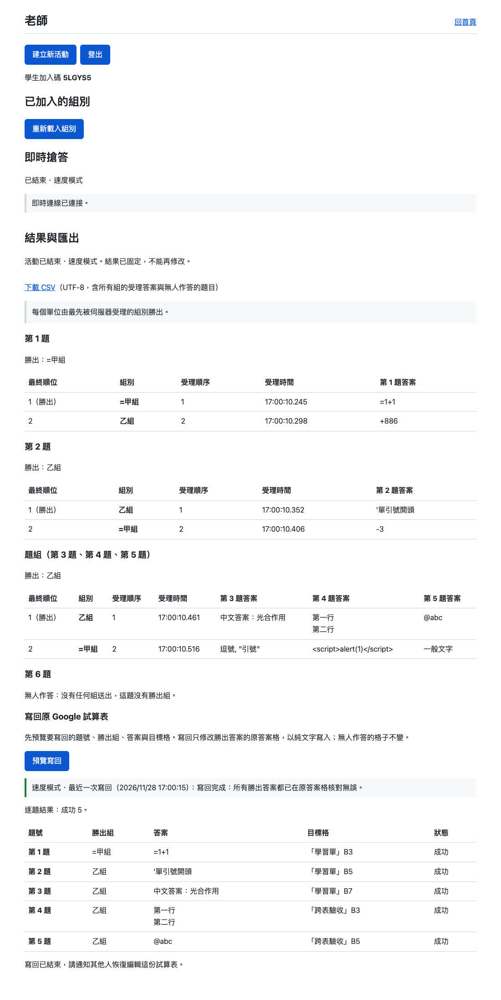

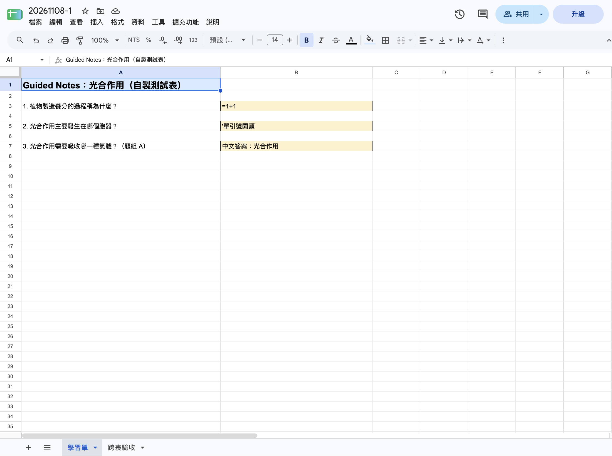

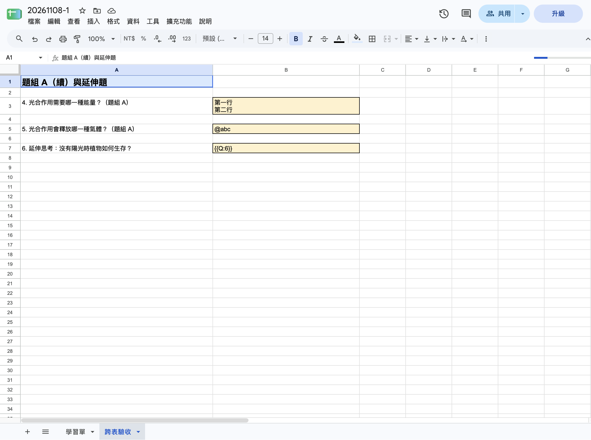

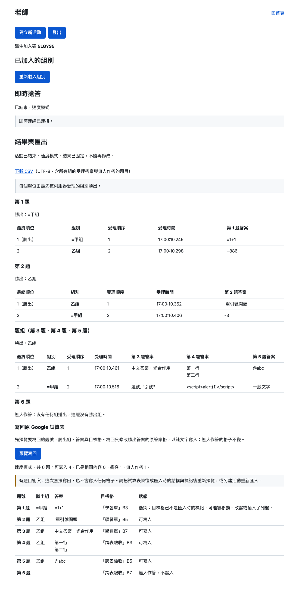

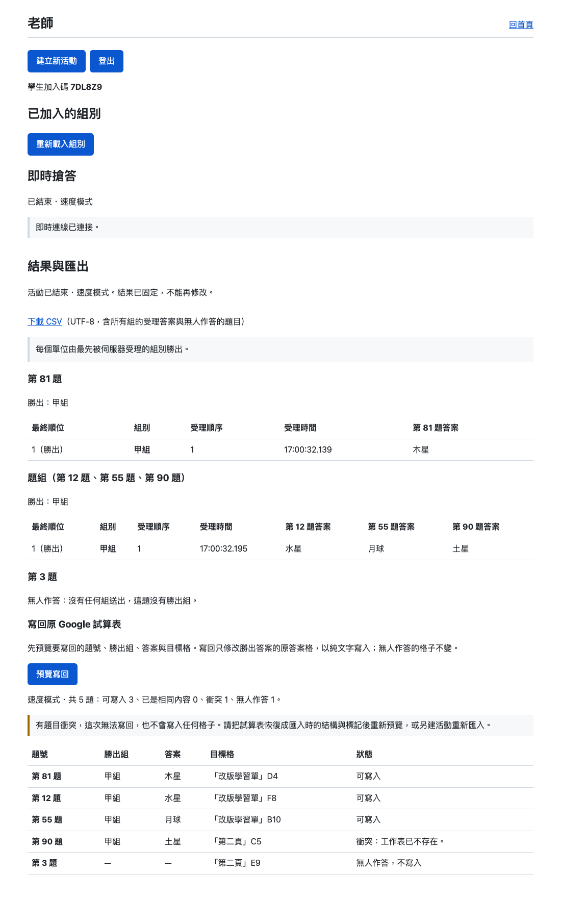

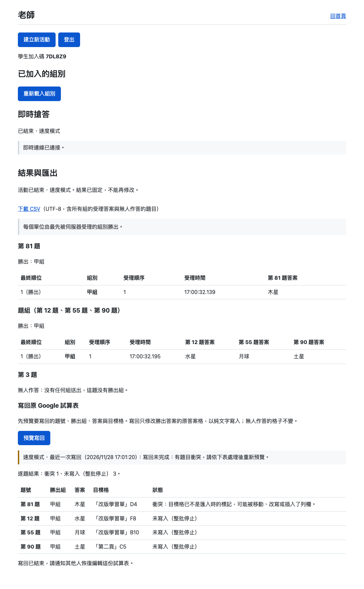

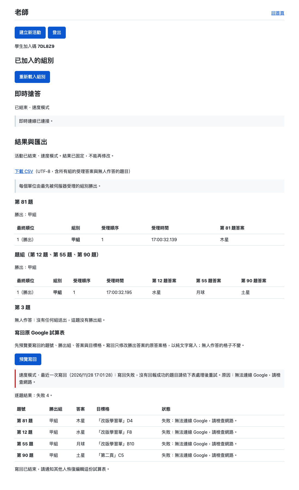

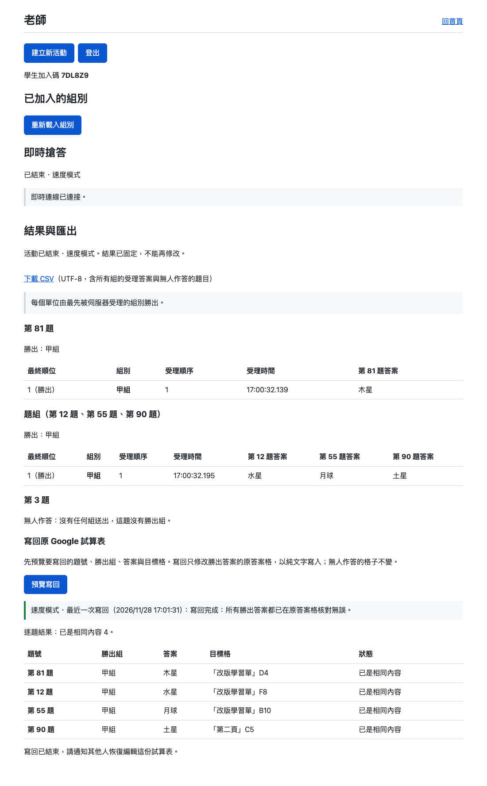

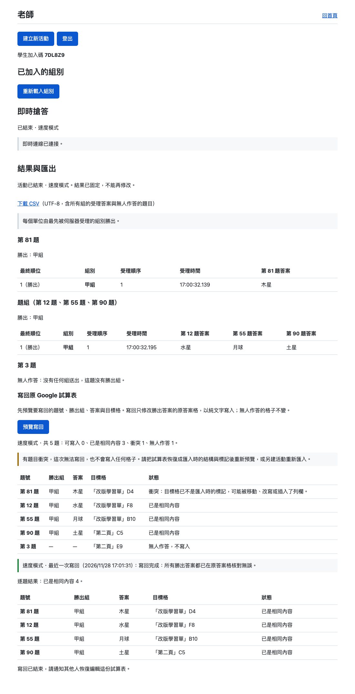

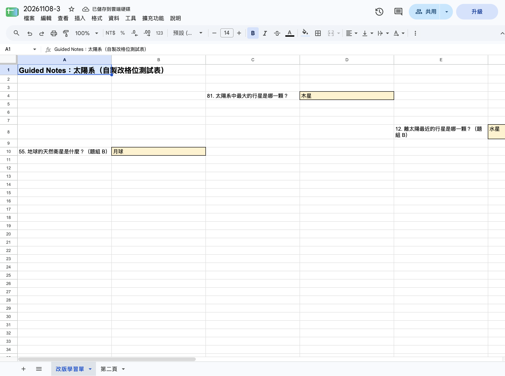

### 人工操作：速度模式（2026-11-28）

45678XYZ 以瀏覽器操作老師頁與兩個學生組（組名「甲」「乙組」），使用本機 `main`（`3e752e7`）的伺服器、驗收用資料庫與
表1（自製測試表）。下列內容由該場活動的資料庫紀錄與下載的 [CSV](evidence/live-manual-speed.csv) 核對，沒有截圖。

- 直接匯入表1：兩張工作表共 6 題、4 個作答單位（AC-01、AC-17 匯入部分）。
- 兩組在開啟前加入；17:48 開啟搶答，依序受理第 1 題甲→乙、第 2 題乙→甲、題組乙→甲，第 6 題無人送出。
- 17:52 結束：第 1 題「甲」勝，第 2 題與題組「乙組」勝，第 6 題無人作答（AC-05、AC-11）。
- 下載的 CSV 有 BOM 與 CRLF；中文與答案內換行保留，`=1+1`、`+886`、`-3`、`@abc` 前有單引號，腳本文字原樣保存，
  無人作答的第 6 題有一列（AC-19）。

這次人工操作**沒有做**寫回試算表與衝突重試、公平模式、伺服器重啟、斷網與版面變更情境；這些項目的依據仍是上述
自動化執行。

## 試算表軟體驗收

- [x] AC-20：以實際的試算表軟體開啟下載的 CSV，確認中文正常、公式開頭的內容以文字顯示（附截圖）

2026-11-28 由 45678XYZ 以 macOS 的 Microsoft Excel 開啟上述速度模式活動下載的 [CSV](evidence/live-speed.csv)：
中文正常；組名 `=甲組` 與答案 `=1+1`、`+886`、`-3`、`@abc` 前的單引號保留，以文字顯示、沒有被計算。

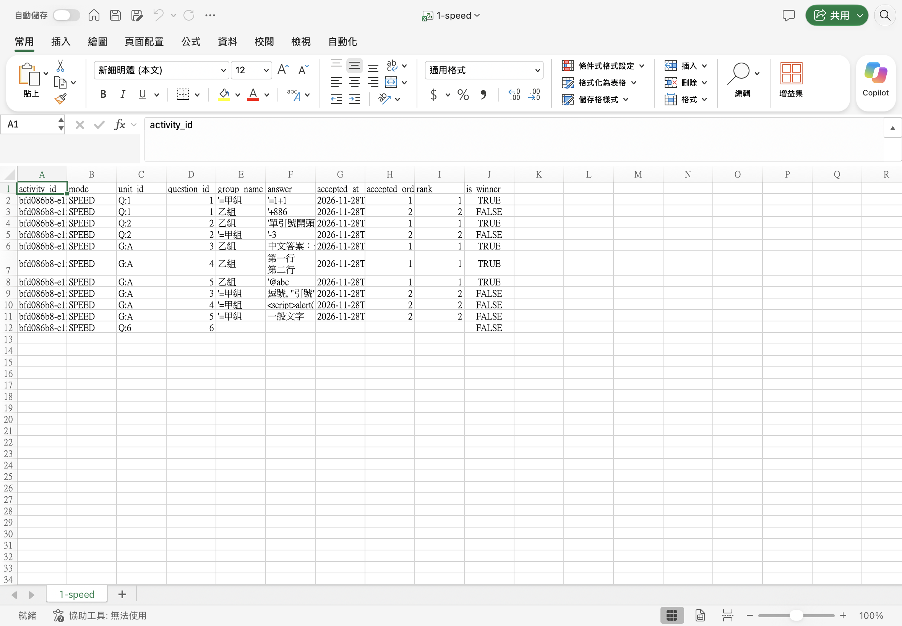
