# SF-05 驗收紀錄

負責人為 45678XYZ。驗收範圍見 [SF-05 規格](spec.md)。

> 2026-11-28 起（#32）「受理順序」與 `accepted_order` 改為整場活動的受理序號。下方較早的驗收紀錄、截圖與 CSV 中的
> 編號是改動前的單位內名次；順位、勝出組與寫回內容不受影響。

## 自動化

Node.js 26.5.0 上執行 `npm test` 全部通過，其中 SF-05 自己的測試檔有 34 項。SF-04 的
[`results.test.js`](../../tests/unit/results-export/results.test.js) 把「公平模式無法結束」改寫為三項（公平模式結束、保存失敗回滾、
未登錄的模式被拒絕）。

- **AC-21**。A、B 兩組都送出兩個單位且 A 兩次較快：第一單位 A 勝出，第二單位 B 因此前勝出次數較少而排第 1 並勝出，
  受理序號沒有改變，結果頁與 CSV 的「受理順序」仍是 A 在前、「最終順位」是 B 在前。
  [順位測試](../../tests/unit/fair-ranking/fair-ranking.test.js) ·
  [結束測試](../../tests/unit/results-export/results.test.js) ·
  [HTTP 測試](../../tests/integration/fair-ranking/fair-ranking.test.js)
- **AC-22**。勝出次數相同時依受理序號；勝出較多的組排最後；題組只算一次勝出；無人作答的單位不增加次數；沒有送出某單位的組
  不被排名；單位順序取自輸入陣列而不是單位編號；跨活動不沿用勝出歷史。另以固定種子產生 200 個隨機活動（最多 10 組、20 個單位），
  檢查每個單位的順位恰為 1..n、輸出順序符合「先前勝出次數、受理序號」、每個有送出的單位恰有一位勝出者。
  沒有任何送出的公平活動可以結束；保存失敗時整個結束回滾、活動仍為搶答中；以檔案型 SQLite 重啟後，結果、CSV 與寫回所依據的
  勝出答案都與重啟前相同。
- **AC-23**。準備中可改選與選回目前的模式，開啟後與結束後一律 409（含選回相同模式）且模式不變；學生、未登入者、缺少 CSRF、
  錯誤 Origin 都被拒絕；body 不合法為 400、活動不存在為 404。改選與開啟在同一刻送出，重複 20 次都只有一種結果；兩個同時的
  改選都成功並留下一致的模式。改選後 2 秒內，老師與已加入的學生的 SSE 快照都收到新模式，改選之後才加入的學生看到最新模式。
  公平模式結束後，結果頁、CSV 與寫回預覽的勝出組、答案、順位與模式一致：CSV 的 `mode` 為 `FAIR`，`rank` 與 `accepted_order`
  分開，寫回預覽第二單位的內容是乙組的答案而不是最先受理的甲組。同一流程在速度模式下行為與 SF-04 相同。
- **AC-09、AC-16**。公平模式搶答中，甲組學生在乙組送出前後取得的快照完全相同，不含乙組的名稱或答案，欄位與速度模式相同，
  沒有任何勝出次數或順位欄位；教師快照在公平模式沒有暫定勝出者，並依受理序號列出送出。結束前學生拿不到結果，結束後只讀得到
  自己所屬活動的結果。
- **SC-003 的「直接修改資料」**。開啟後資料庫層拒絕改模式，由既有的
  [`base-schema.test.js`](../../tests/unit/base-schema.test.js)（「mode can change while PREPARING and is locked once OPEN」）涵蓋。
- **測試的鑑別力**。暫時把 `RANKERS.FAIR` 換成速度規則，AC-21、AC-22、AC-23 一致性、重啟與結束保存共 5 項測試失敗；
  還原後全部通過。

## 瀏覽器驗證

2026-11-20 以 Google Chrome（headless，經 DevTools Protocol 操作）、三個獨立的瀏覽器工作階段（老師、甲組、乙組）與實際的本機
HTTP／SSE 驗證，Google Sheets 以記憶體中的測試替身代替（只用於這次畫面檢查，不取代真實線上驗收）。24 項檢查全部通過，
頁面沒有 JavaScript 錯誤。

- 準備中，新活動預設為速度模式。老師選「公平模式」後，老師畫面顯示規則與範例；學生畫面不重新整理就更新，三次執行的延遲為
  157～654 毫秒（SC-003 要求 2 秒內）。只用鍵盤（方向鍵）也能在兩種模式間切換，學生畫面同步更新。
- 開啟後選擇區唯讀並顯示「活動已開啟，模式已鎖定。」，用頁面的 `apiFetch` 再要求改選，伺服器回 `INVALID_PHASE`。
  公平模式搶答中，監看表的勝出欄顯示「結束時計算」，沒有暫定勝出者。
- 甲組兩個單位都先送出，老師確認結束後約 0.05～0.3 秒，老師與學生畫面自動顯示結果（SC-002）：第二單位乙組為「1（勝出）」、
  受理順序 2，甲組為最終順位 2、受理順序 1；結果頁顯示公平模式規則與範例，選擇區與學生模式區讓位給結果。
- 預覽寫回標示「公平模式・」，第二單位寫入乙組的答案；寫回後紀錄同樣標示模式，測試替身中兩個目標格是甲組第一題與乙組第二題。
  下載的 CSV：第二單位乙組 `rank` 1、`accepted_order` 2、`is_winner` 為 `true`。

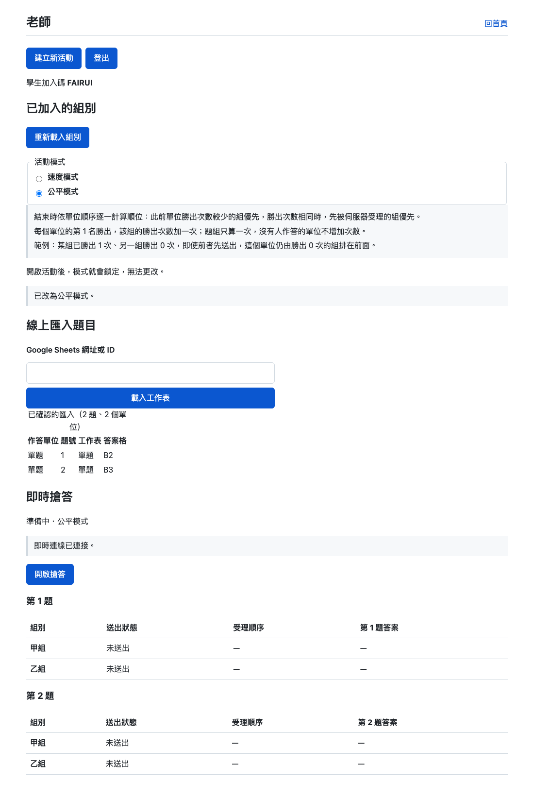

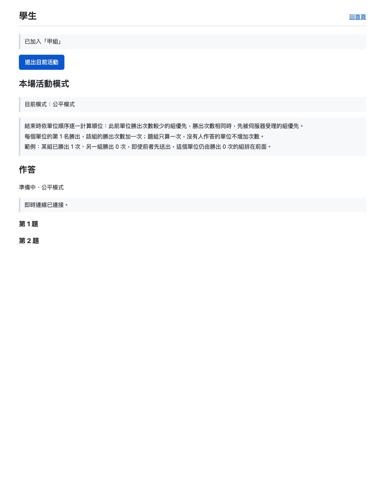

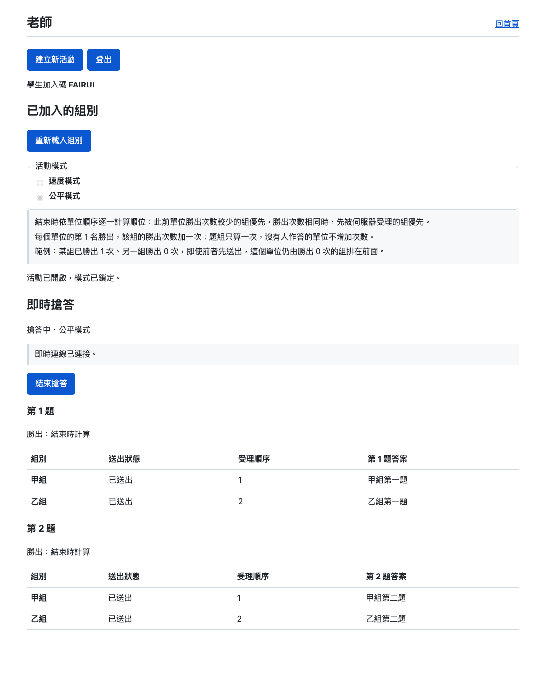

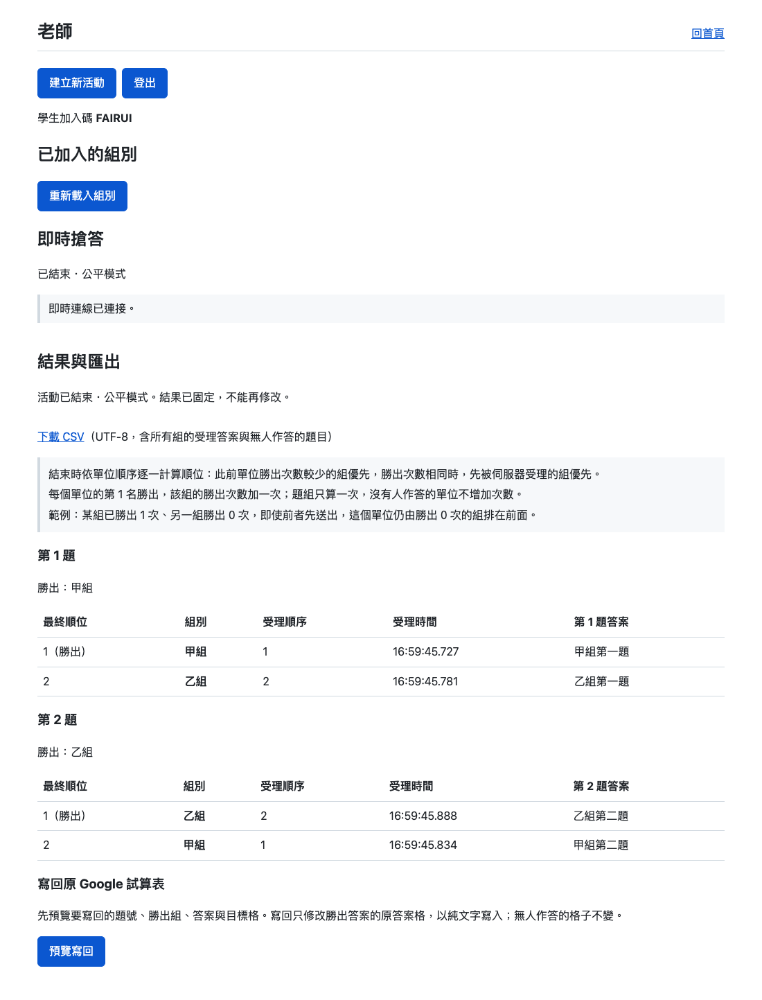

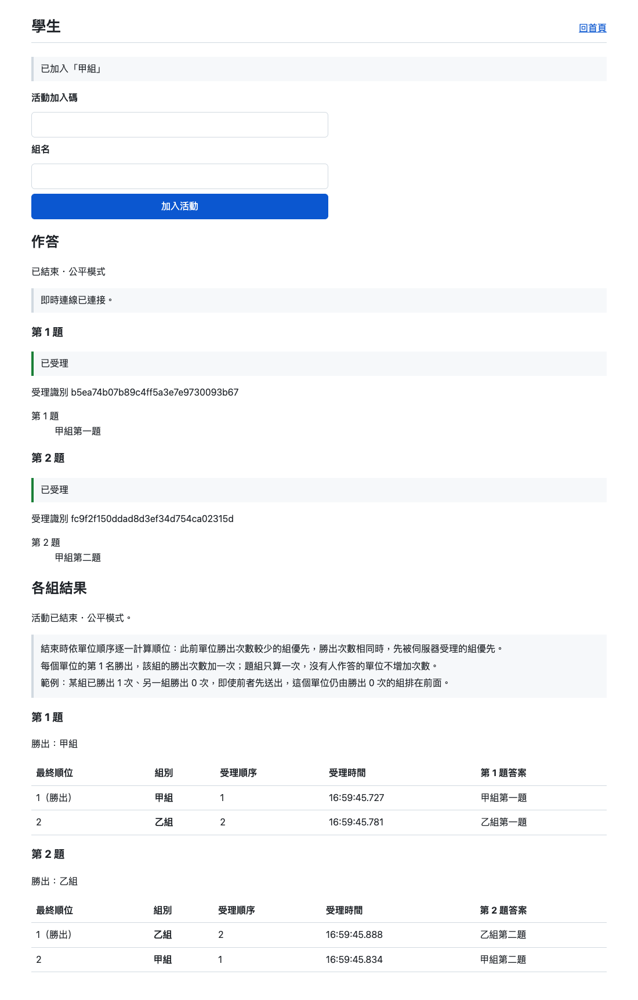

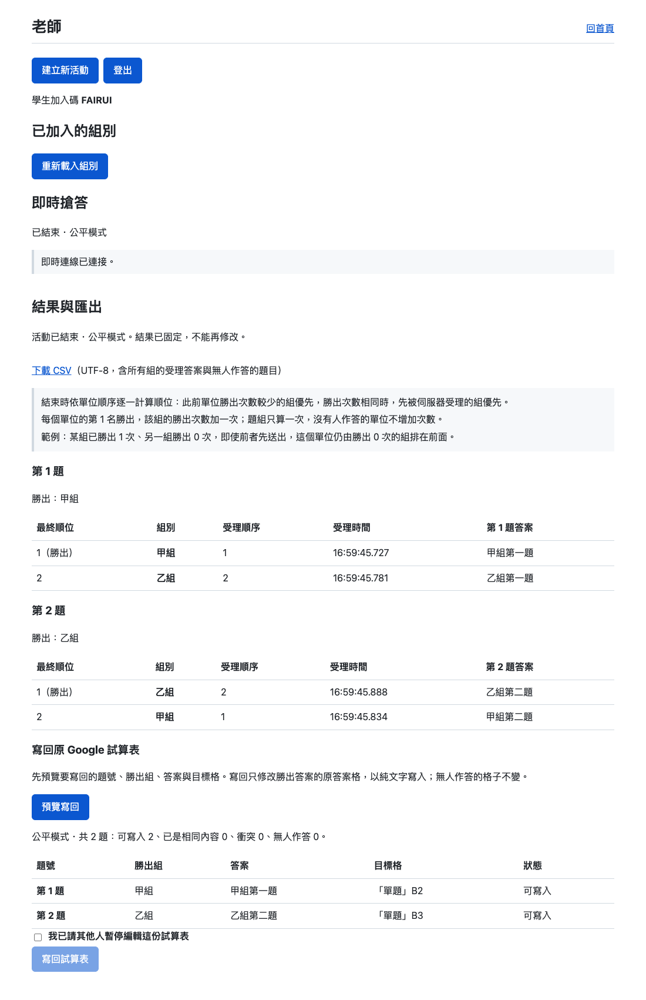

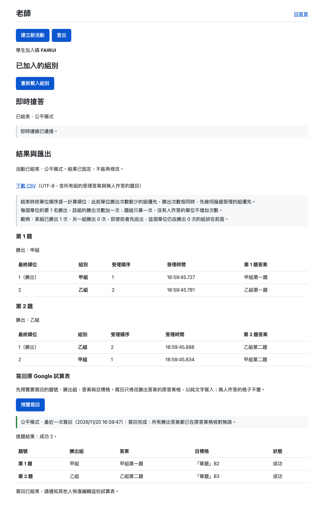

## 真實線上試算表驗收

2026-11-28 在 `main` 提交 `3e752e7` 以真實 Google Sheets 執行（#20，與 SF-04 同一次）：速度模式用表1、公平模式用表2，
由 AI 代理以瀏覽器自動化操作，使用自製測試表。執行方式、限制與試算表連結見
[SF-04 紀錄](../004-results-export/acceptance.md#真實線上試算表驗收)。

- [x] 公平模式活動結束後預覽並寫回：預覽標示公平模式，第二單位寫入順位 1 的組的答案，開啟原試算表核對原格內容（AC-23、AC-17）
  （第二單位乙組順位 1、受理順序 2，表2 B5 寫入乙組的「凝結」，45678XYZ 人工開啟表2 核對；準備中改選模式
  0.21～0.27 秒同步到兩組，開啟後改選回 `INVALID_PHASE`；重啟伺服器後老師與學生的結果不變；
  [CSV](evidence/live-fair.csv) 標示 `FAIR`）
- [x] 兩種模式各走一次 spec.md §8 的共通情境（單題、題組、無人作答、衝突與重試），結果頁、試算表與 CSV 一致
  （兩種模式各含兩個單題、跨工作表的三題題組與一個無人作答單位；改寫目標格造成衝突，復原後寫回成功，
  重複寫回沒有送出寫入要求）

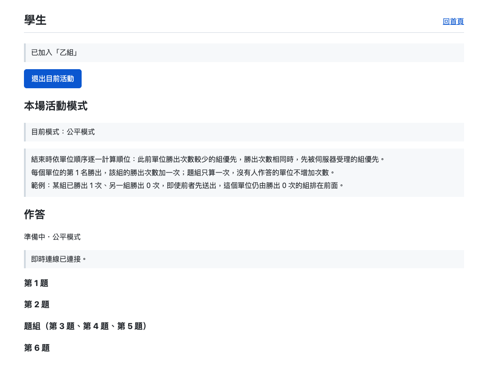

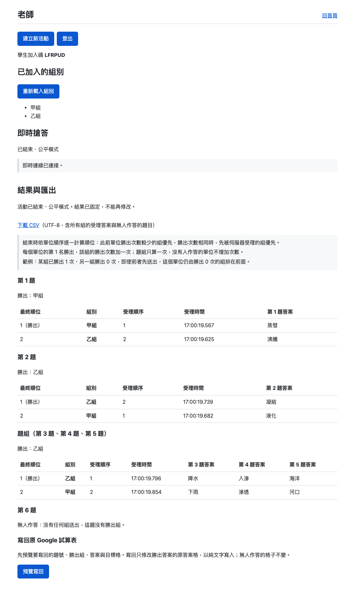

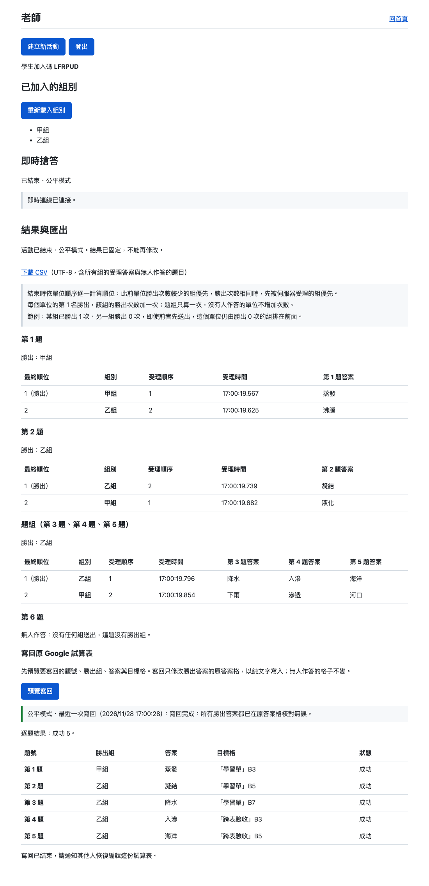

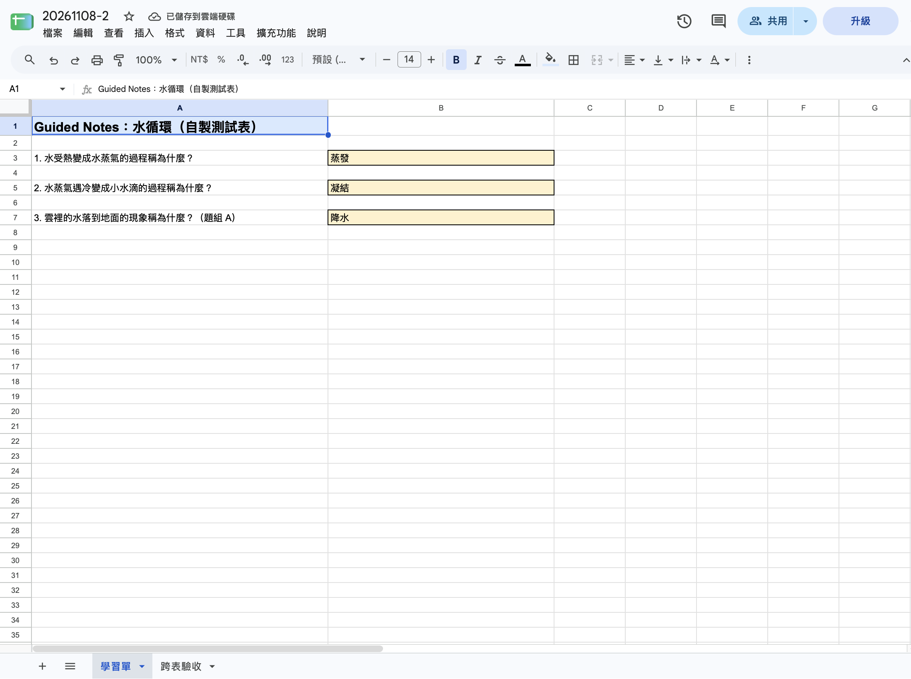
